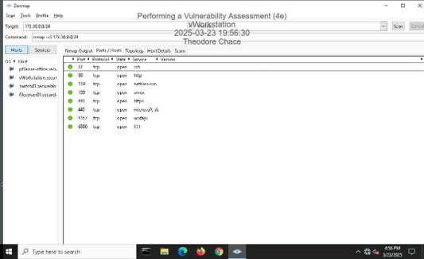
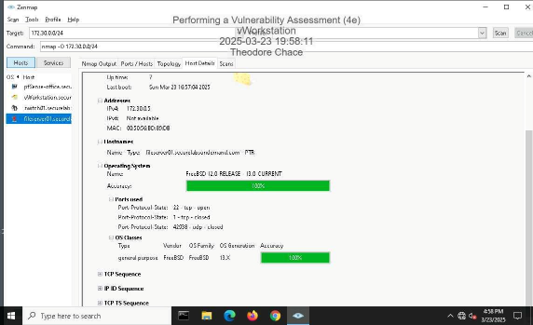
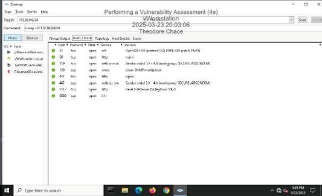
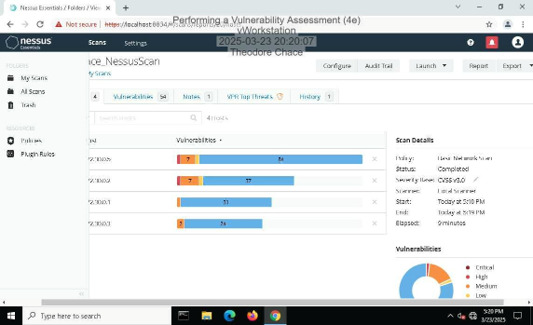
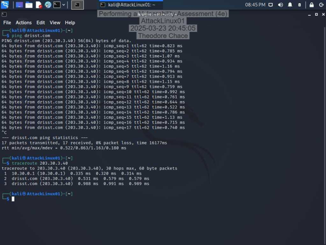
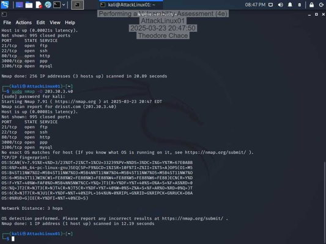
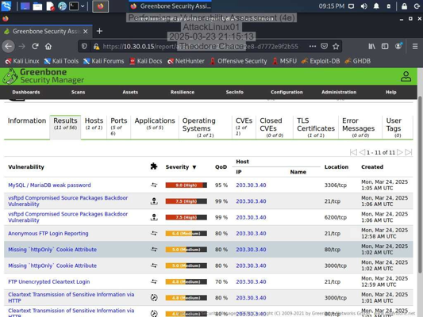
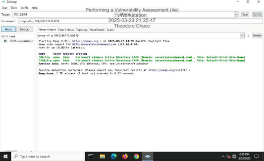
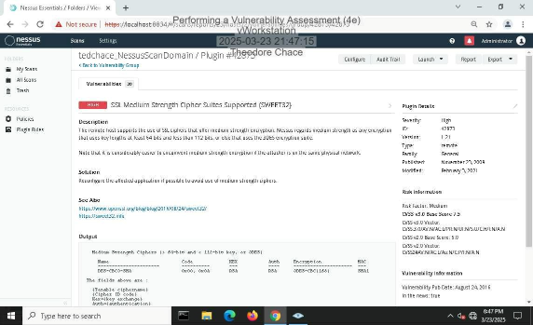

# Performing a Vulnerability Assessment

## Objective

The Performing a Vulnerability Assessment Lab was an academic Systems Security exercise completed at Saint Leo University in March 2025.

The objective was to identify and evaluate security vulnerabilities within a simulated network environment using Zenmap, Nmap, Nessus, and OpenVAS. The lab involved examining network hosts, identifying open ports and services, reviewing operating system information, conducting vulnerability scans, evaluating security findings, and developing remediation recommendations.

The investigation was organized into three major sections: Hands-On Demonstration, Applied Learning, and Challenge and Analysis.

These activities provided practical experience in network reconnaissance, vulnerability assessment, risk evaluation, security documentation, and remediation planning.

### Skills Learned

- Conducted network reconnaissance and host enumeration using Zenmap and Nmap.
- Performed TCP SYN scans to identify open ports and accessible services.
- Examined operating system detection and service identification results.
- Used traceroute to examine network connectivity and routing paths.
- Conducted vulnerability scans using Nessus and OpenVAS.
- Reviewed vulnerability scan summaries and individual security findings.
- Evaluated vulnerabilities using documented severity ratings and CVSS scores.
- Analyzed SSL/TLS certificate trust and encryption-related weaknesses.
- Identified weak authentication configurations and vulnerable network services.
- Documented vulnerability findings and recommended remediation strategies.
- Performed targeted network and vulnerability scans against a simulated domain controller.
- Prepared structured security assessment reports describing scope, findings, severity, and remediation recommendations.
- Strengthened vulnerability analysis, technical documentation, and network security assessment skills.

### Tools Used

- **Zenmap** for graphical network scanning, TCP SYN scans, operating system detection, and service enumeration.
- **Nmap** for command-line network reconnaissance, port scanning, and operating system detection.
- **Nessus** for vulnerability scanning, severity assessment, and vulnerability report analysis.
- **OpenVAS / Greenbone Security Manager** for vulnerability identification and detailed security finding analysis.
- **Kali Linux** as the environment used for command-line network assessment activities.

## Steps

### 1. Network Reconnaissance with Zenmap

Began the Hands-On Demonstration section by using Zenmap to examine hosts within the provided lab network.

Performed a TCP SYN scan and reviewed the Ports/Hosts results for the assigned file server.

The scan provided information about accessible TCP ports and associated services, supporting the identification of potential network exposure points.

*Ref 1: Zenmap TCP SYN scan displaying open ports and associated services on the assigned file server.*

---

### 2. Operating System Detection and Service Enumeration

Continued examining the assigned file server using Zenmap's operating system detection and service scanning functionality.

Reviewed host details to examine operating system identification results and additional host information.

*Ref 2: Zenmap Host Details tab displaying operating system detection information for the assigned file server.*

Performed a service scan to obtain additional information about accessible network services.

The service scan provided information useful for understanding the applications and protocols exposed by the target host.

*Ref 3: Zenmap service enumeration results showing identified services and associated ports.*

---

### 3. Vulnerability Scanning with Nessus

Used Nessus to conduct a vulnerability scan within the simulated network environment.

Reviewed the completed scan summary, including identified hosts, vulnerability counts, and reported severity categories.

The results provided an overview of the security findings requiring further examination.

*Ref 4: Nessus scan summary displaying discovered vulnerabilities across the assessed lab hosts.*

---

### 4. Evaluating an SSL Certificate Vulnerability

Selected a Nessus vulnerability finding for further analysis:

**Plugin 51192 - SSL Certificate Cannot Be Trusted**

The lab report documented a **CVSS score of 6.5** for this finding.

The vulnerability concerns a certificate trust issue that may prevent a client from reliably validating the identity of the remote service.

The documented remediation recommendations included:

- Ensuring the SSL certificate is current and has not expired.
- Confirming that the certificate matches the intended hostname.
- Ensuring that the certificate is correctly signed and can be trusted.

This activity demonstrated how individual vulnerability findings can be evaluated and translated into recommended corrective actions.

---

### 5. Network Reconnaissance with Nmap

In the Applied Learning section, used Kali Linux and command-line network utilities to examine the assigned lab target.

Performed connectivity testing and traceroute analysis to observe the network path toward the target.

*Ref 5: Kali Linux terminal showing connectivity testing and traceroute results for the assigned assessment target.*

Continued the assessment with Nmap, including scanning with operating system detection enabled.

The scan output provided port and service information and reported the results of the operating system detection attempt.

*Ref 6: Nmap command-line scan showing discovered ports, services, and operating system detection output.*

---

### 6. Vulnerability Scanning with OpenVAS

Used OpenVAS through Greenbone Security Manager to conduct a vulnerability scan of the assigned lab target.

Reviewed the detailed results to identify reported weaknesses, severity ratings, and affected services.

The scan identified findings involving weak authentication configurations, vulnerable FTP services, and other security weaknesses.

*Ref 7: OpenVAS detailed vulnerability scan results showing identified weaknesses and their reported severity ratings.*

---

### 7. Vulnerability Findings and Remediation Recommendations

Prepared the assessment report for the assigned target, documenting the purpose, scope, high-severity findings, and recommended corrective actions.

The report highlighted the following findings:

**MySQL/MariaDB Weak Password**

- **Reported Severity:** 9.0 (High)
- **Finding:** Weak database credentials could increase the risk of unauthorized access.
- **Recommended Mitigation:** Reset weak passwords and apply stronger password practices to reduce authentication-related risk.

**vsftpd Compromised Source Packages Backdoor Vulnerability**

- **Reported Severity:** 7.5 (High)
- **Finding:** A vulnerability involving compromised vsftpd source packages could expose the affected service to unauthorized access.
- **Recommended Mitigation:** Restrict unnecessary access and strengthen the security of affected services and files.

The lab report included two high-severity scan entries associated with the vsftpd compromised-source-packages vulnerability. These were documented as separate findings in the assignment, although they referenced the same vulnerability name.

The assessment reinforced the importance of examining scan results, identifying significant risks, and documenting recommendations appropriate to the reported weaknesses.

---

### 8. Domain Controller Network Assessment

In the Challenge and Analysis section, performed a targeted Nmap port scan against the domain controller within the simulated network.

The purpose was to examine accessible services on the domain controller and collect information for further vulnerability assessment.

*Ref 8: Targeted Nmap scan displaying results for the simulated domain controller.*

---

### 9. Domain Controller Vulnerability Assessment and Reporting

Used Nessus to examine the domain controller for reported security vulnerabilities.

The scan identified:

**SSL Medium Strength Cipher Suites Supported (SWEET32)**

The lab report documented this finding with a **severity score of 7.5 (High)**.

The reported weakness concerned the support of medium-strength cipher suites, potentially exposing encrypted communications to security risks.

*Ref 9: Nessus vulnerability details for the domain controller, including the SSL Medium Strength Cipher Suites Supported (SWEET32) finding.*

The assessment report recommended avoiding medium-strength cipher suites and upgrading affected configurations to stronger encryption options.

The final domain controller report documented the assessment purpose, limited scope, identified vulnerability, reported severity, and recommended mitigation.

---

### 10. Findings and Reporting

The lab concluded with written vulnerability assessment reports covering the assigned network target and simulated domain controller.

The reports documented:

- Assessment objectives and defined scope.
- Identified network services and security weaknesses.
- Vulnerability names and reported severity ratings.
- Potential security implications of the identified findings.
- Recommended remediation strategies.
- Conclusions regarding the observed security risks.

The project strengthened my understanding of how network reconnaissance and automated vulnerability scanning support the identification, evaluation, and documentation of security weaknesses.

**Project Scope:** This was an authorized academic lab using assigned systems and assessment targets. The submitted work documents scanning, findings analysis, and remediation recommendations; it does not demonstrate exploitation or verification that the proposed remediation actions were implemented.
